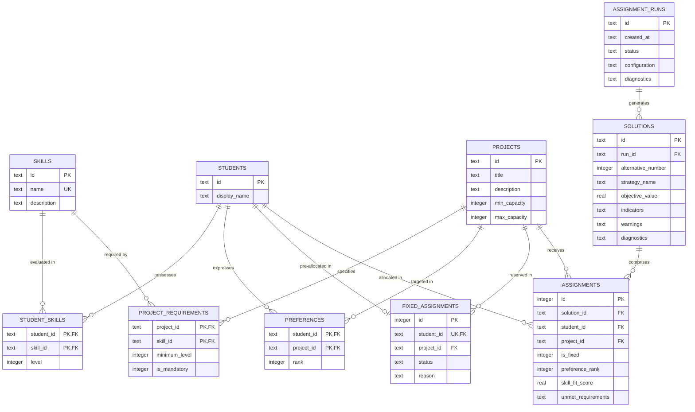

# TECH5 Assignment Support System: Relational Database Design Specification

## 1. Relational Data Architecture Overview

The persistence architecture of the TECH5 Decision Support System is implemented as a **Third Normal Form (3NF)** relational database in SQLite. It provides atomic transactions, cascading referential integrity, and high-performance querying for both transactional updates (CRUD) and analytical aggregations (evaluation indicators and historical audits).

### Core Database Configuration
- **SQLite Version**: SQLite 3 (supported in standard Python `sqlite3`).
- **Journal Mode**: `WAL` (Write-Ahead Logging) for non-blocking concurrent reads during optimization persistence.
- **Foreign Key Enforcement**: Explicitly activated upon every connection (`PRAGMA foreign_keys = ON;`).
- **Encoding**: UTF-8 with standard collation.

---

## 2. Entity-Relationship (ER) Diagram



---

Composite uniqueness is scoped to `preferences(student_id, rank)`,
`solutions(run_id, alternative_number)`, and
`assignments(solution_id, student_id)`. Neither `rank` nor `alternative_number`
is individually unique. The DDL below gives the complete constraints.

## 3. Relational Table Definitions & Constraints

### 3.1 `skills` (Skills Catalog)
Stores the standardized taxonomy of technical and domain competencies:
```sql
CREATE TABLE IF NOT EXISTS skills (
    id TEXT PRIMARY KEY,
    name TEXT NOT NULL UNIQUE,
    description TEXT DEFAULT ''
);
```

### 3.2 `students` (Student Roster)
Stores student identification:
```sql
CREATE TABLE IF NOT EXISTS students (
    id TEXT PRIMARY KEY,
    display_name TEXT NOT NULL
);
```

### 3.3 `projects` (Project Catalog & Capacities)
Enforces capacity domain integrity rules directly at the schema layer:
```sql
CREATE TABLE IF NOT EXISTS projects (
    id TEXT PRIMARY KEY,
    title TEXT NOT NULL,
    description TEXT DEFAULT '',
    min_capacity INTEGER NOT NULL DEFAULT 0 CHECK(min_capacity >= 0),
    max_capacity INTEGER NOT NULL CHECK(max_capacity >= 1),
    CHECK(min_capacity <= max_capacity)
);
```

### 3.4 `student_skills` (Student Proficiency Matrix)
Resolves many-to-many relationship between students and skills:
```sql
CREATE TABLE IF NOT EXISTS student_skills (
    student_id TEXT NOT NULL,
    skill_id TEXT NOT NULL,
    level INTEGER NOT NULL DEFAULT 1 CHECK(level >= 1),
    PRIMARY KEY (student_id, skill_id),
    FOREIGN KEY (student_id) REFERENCES students(id) ON DELETE CASCADE,
    FOREIGN KEY (skill_id) REFERENCES skills(id) ON DELETE CASCADE
);
```

### 3.5 `project_requirements` (Project Skill Requirements)
Specifies minimum required competency level and mandatory flags:
```sql
CREATE TABLE IF NOT EXISTS project_requirements (
    project_id TEXT NOT NULL,
    skill_id TEXT NOT NULL,
    minimum_level INTEGER NOT NULL DEFAULT 1 CHECK(minimum_level >= 1),
    is_mandatory INTEGER NOT NULL DEFAULT 0 CHECK(is_mandatory IN (0, 1)),
    PRIMARY KEY (project_id, skill_id),
    FOREIGN KEY (project_id) REFERENCES projects(id) ON DELETE CASCADE,
    FOREIGN KEY (skill_id) REFERENCES skills(id) ON DELETE CASCADE
);
```

### 3.6 `preferences` (Student Ranked Preferences)
Prevents duplicate project preference ranking for the same student via composite unique constraint `uq_student_rank`:
```sql
CREATE TABLE IF NOT EXISTS preferences (
    student_id TEXT NOT NULL,
    project_id TEXT NOT NULL,
    rank INTEGER NOT NULL CHECK(rank >= 1),
    PRIMARY KEY (student_id, project_id),
    FOREIGN KEY (student_id) REFERENCES students(id) ON DELETE CASCADE,
    FOREIGN KEY (project_id) REFERENCES projects(id) ON DELETE CASCADE,
    CONSTRAINT uq_student_rank UNIQUE (student_id, rank)
);
```

### 3.7 `fixed_assignments` (Administrative Pre-Allocations)
Guarantees at the schema level that a student can be locked to at most one project (`student_id TEXT NOT NULL UNIQUE`):
```sql
CREATE TABLE IF NOT EXISTS fixed_assignments (
    id INTEGER PRIMARY KEY AUTOINCREMENT,
    student_id TEXT NOT NULL UNIQUE,
    project_id TEXT NOT NULL,
    status TEXT NOT NULL DEFAULT 'APPROVED',
    reason TEXT DEFAULT '',
    FOREIGN KEY (student_id) REFERENCES students(id) ON DELETE CASCADE,
    FOREIGN KEY (project_id) REFERENCES projects(id) ON DELETE CASCADE
);
```

### 3.8 `assignment_runs` (Historical Execution Audit)
Audits optimization runs, input parameters, and solver logs:
```sql
CREATE TABLE IF NOT EXISTS assignment_runs (
    id TEXT PRIMARY KEY,
    created_at TEXT NOT NULL,
    status TEXT NOT NULL,
    configuration TEXT NOT NULL,
    diagnostics TEXT NOT NULL
);
```

### 3.9 `solutions` (Alternative Feasible Solutions)
Guarantees unique alternative numbering within an optimization run:
```sql
CREATE TABLE IF NOT EXISTS solutions (
    id TEXT PRIMARY KEY,
    run_id TEXT NOT NULL,
    alternative_number INTEGER NOT NULL,
    strategy_name TEXT NOT NULL,
    objective_value REAL,
    indicators TEXT NOT NULL,
    warnings TEXT NOT NULL,
    diagnostics TEXT NOT NULL,
    FOREIGN KEY (run_id) REFERENCES assignment_runs(id) ON DELETE CASCADE,
    CONSTRAINT uq_run_alternative UNIQUE (run_id, alternative_number)
);
```

### 3.10 `assignments` (Detailed Student Allocations)
Stores the individual match tuples. Guarantees that within a solution, a student is assigned to at most one project (`uq_solution_student`).
This constraint does not require an assignment row for every student; complete
allocation is enforced by the assignment engine:
```sql
CREATE TABLE IF NOT EXISTS assignments (
    id INTEGER PRIMARY KEY AUTOINCREMENT,
    solution_id TEXT NOT NULL,
    student_id TEXT NOT NULL,
    project_id TEXT NOT NULL,
    is_fixed INTEGER NOT NULL DEFAULT 0 CHECK(is_fixed IN (0, 1)),
    preference_rank INTEGER,
    skill_fit_score REAL NOT NULL DEFAULT 0.0,
    unmet_requirements TEXT DEFAULT '[]',
    FOREIGN KEY (solution_id) REFERENCES solutions(id) ON DELETE CASCADE,
    FOREIGN KEY (student_id) REFERENCES students(id) ON DELETE CASCADE,
    FOREIGN KEY (project_id) REFERENCES projects(id) ON DELETE CASCADE,
    CONSTRAINT uq_solution_student UNIQUE (solution_id, student_id)
);
```

---

## 4. Third Normal Form (3NF) Justification

The relational design satisfies all conditions of 3NF:

1. **First Normal Form (1NF)**:
   - All column values are atomic (e.g. skills and preferences are broken into discrete relational rows rather than comma-separated strings).
   - Every table possesses a well-defined primary key.
2. **Second Normal Form (2NF)**:
   - Meets 1NF.
   - Every non-key attribute is fully functionally dependent on the entire primary key:
     - In `student_skills(student_id, skill_id)`, `level` depends on both the student and the skill.
     - In `project_requirements(project_id, skill_id)`, `minimum_level` and `is_mandatory` depend on both the project and the skill.
     - In `preferences(student_id, project_id)`, `rank` depends on the pair.
3. **Third Normal Form (3NF)**:
   - Meets 2NF.
   - No transitive functional dependencies exist ($X \to Y \to Z$).
   - Auxiliary entity attributes (such as skill descriptions, student display names, project capacities) are stored exclusively in their parent entity tables and referenced via foreign keys, eliminating update and deletion anomalies.

---

## 5. Non-Trivial Analytical SQL Queries

The four queries below are illustrative documentation examples. The separate
`app/persistence/queries.sql` contains six representative examples; the
application does not load or execute that file at runtime. Runtime CRUD and
run/solution retrieval use parameterized SQL in
`app/persistence/repositories.py`. Runtime metrics and solution comparison are
computed in `app/engine/metrics.py`, called by `app/engine/solvers.py`.

| Documentation example | Corresponding `queries.sql` example | Differences |
| --- | --- | --- |
| 5.1 Capacity utilization | 2 | Different output aliases, status labels and ordering; the file also returns remaining seats. |
| 5.2 Skill deficits | 4 | Equivalent joins and filtering; selected column order differs. |
| 5.3 Rank distribution | 3 | Human-readable choice labels instead of numeric rank buckets; output aliases differ. |
| 5.4 Re-allocation audit | None | Documentation-only self-join; runtime comparison uses Python metrics. |

The SQL file additionally illustrates full assignment details (1), fixed-lock
compliance (5), and run history (6). Bind `:solution_id` for single-solution
examples and `:solution_a_id`/`:solution_b_id` for the audit. Skill-gap queries
join the current cohort tables; they do not reconstruct historical inputs.

### 5.1 Project Allocation & Capacity Utilization Analysis
Computes assigned headcounts, maximum-capacity utilization percentages, and
capacity status. Unlike an application-level feasibility check, this example
only checks project headcounts:
```sql
SELECT 
    p.id AS project_id,
    p.title AS project_title,
    p.min_capacity,
    p.max_capacity,
    COUNT(a.student_id) AS assigned_count,
    ROUND(CAST(COUNT(a.student_id) AS REAL) / p.max_capacity * 100.0, 1) AS max_capacity_utilization_pct,
    CASE 
        WHEN COUNT(a.student_id) > p.max_capacity THEN 'OVER_CAPACITY'
        WHEN COUNT(a.student_id) < p.min_capacity THEN 'UNDER_MIN_CAPACITY'
        WHEN COUNT(a.student_id) = p.max_capacity THEN 'AT_MAX_CAPACITY'
        ELSE 'FEASIBLE'
    END AS capacity_status
FROM projects p
LEFT JOIN assignments a 
    ON p.id = a.project_id 
    AND a.solution_id = :solution_id
GROUP BY p.id, p.title, p.min_capacity, p.max_capacity
ORDER BY p.id ASC;
```

### 5.2 Student Skill Deficit & Gap Analysis
Identifies assigned students who do not meet the minimum skill level requested
by their assigned project. An individual mandatory-skill deficit does not prove
team infeasibility: another assigned student may cover that requirement:
```sql
SELECT 
    a.solution_id,
    a.student_id,
    s.display_name AS student_name,
    a.project_id,
    p.title AS project_title,
    pr.skill_id,
    sk.name AS skill_name,
    pr.minimum_level AS required_level,
    COALESCE(ss.level, 0) AS student_level,
    pr.is_mandatory,
    (pr.minimum_level - COALESCE(ss.level, 0)) AS skill_deficit
FROM assignments a
JOIN students s ON a.student_id = s.id
JOIN projects p ON a.project_id = p.id
JOIN project_requirements pr ON a.project_id = pr.project_id
JOIN skills sk ON pr.skill_id = sk.id
LEFT JOIN student_skills ss 
    ON a.student_id = ss.student_id 
    AND pr.skill_id = ss.skill_id
WHERE a.solution_id = :solution_id
  AND COALESCE(ss.level, 0) < pr.minimum_level
ORDER BY pr.is_mandatory DESC, skill_deficit DESC;
```

### 5.3 Preference Satisfaction & Rank Distribution
Aggregates rank distribution counts and percentages for a given solution:
```sql
SELECT 
    CASE 
        WHEN a.preference_rank IS NULL THEN 'Unranked (Assigned)'
        WHEN a.preference_rank = 1 THEN '1st Choice'
        WHEN a.preference_rank = 2 THEN '2nd Choice'
        WHEN a.preference_rank = 3 THEN '3rd Choice'
        ELSE printf('%dth Choice', a.preference_rank)
    END AS choice_category,
    COUNT(a.student_id) AS student_count,
    ROUND(CAST(COUNT(a.student_id) AS REAL) / (SELECT COUNT(*) FROM assignments WHERE solution_id = :solution_id) * 100.0, 1) AS percentage
FROM assignments a
WHERE a.solution_id = :solution_id
GROUP BY choice_category
ORDER BY MIN(COALESCE(a.preference_rank, 999)) ASC;
```

### 5.4 Cross-Solution Re-Allocation Audit
Identifies students present in both solutions who were assigned to different
projects (e.g. Solution A vs Solution B). The illustrative rank delta uses 99
for an unranked assignment; this is not the runtime comparison policy in
`app/engine/metrics.py`:
```sql
SELECT 
    s.id AS student_id,
    s.display_name AS student_name,
    asg_a.project_id AS solution_a_project,
    asg_a.preference_rank AS solution_a_rank,
    asg_b.project_id AS solution_b_project,
    asg_b.preference_rank AS solution_b_rank,
    (COALESCE(asg_b.preference_rank, 99) - COALESCE(asg_a.preference_rank, 99)) AS rank_delta
FROM assignments asg_a
JOIN assignments asg_b 
    ON asg_a.student_id = asg_b.student_id
JOIN students s 
    ON s.id = asg_a.student_id
WHERE asg_a.solution_id = :solution_a_id
  AND asg_b.solution_id = :solution_b_id
  AND asg_a.project_id != asg_b.project_id
ORDER BY s.id ASC;
```
